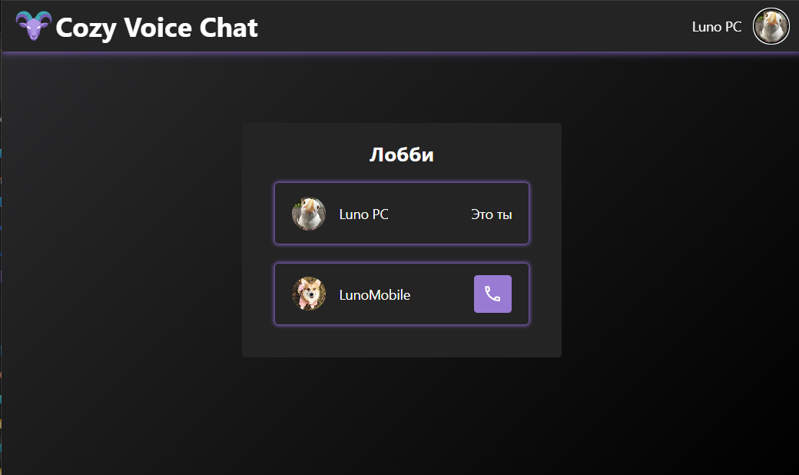
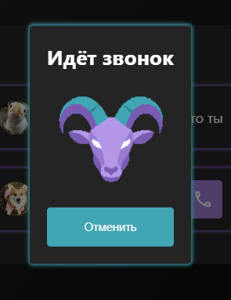
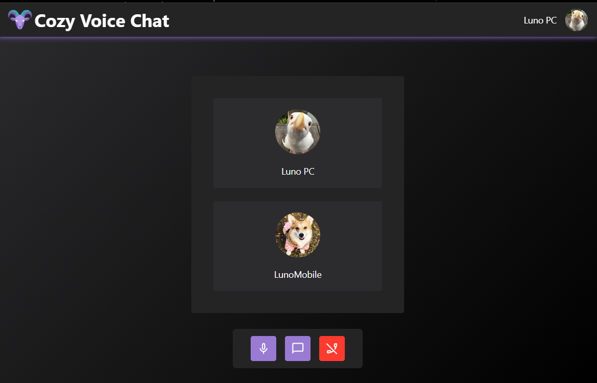
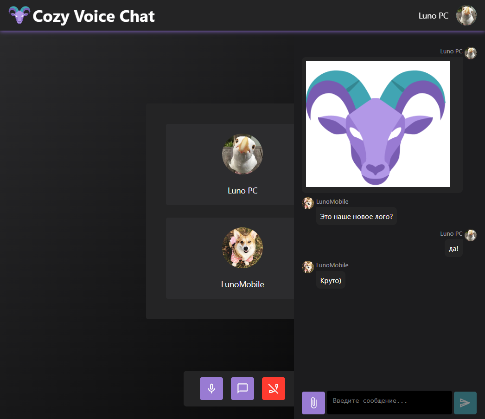

<div align="center">


# 🐐 Cozy Voice Chat

**Локальный P2P голосовой чат для созвонов по LAN**

_Нулевой пинг. Гигабитная передача файлов. Уютные звонки 1-на-1 и групповые комнаты._

</div>

---

## 📖 О проекте

**Cozy Voice Chat** — это локальный голосовой чат, созданный для комфортных созвонов в локальной сети. Благодаря P2P-архитектуре (WebRTC через PeerJS) голосовой трафик идёт напрямую между участниками, обеспечивая **нулевой пинг** и минимальные задержки.

Проект родился из простой идеи: иметь свой уютный мессенджер для звонков по LAN с возможностью быстро перекидывать тяжёлые файлы на гигабитной скорости локальной сети 🚀

### ✨ Возможности

- 🎙️ **Голосовые звонки 1-на-1** через P2P (WebRTC)
- 👥 **Групповые комнаты по ссылке** — создайте комнату в лобби и поделитесь ссылкой `/join/ABC123`. Комната живёт, пока в ней есть участники, и поддерживает до 6 человек. Голос идёт напрямую между всеми участниками по mesh-схеме WebRTC, без медиасервера
- 🔌 **Устойчивость к отключению микрофона** — если устройство пропало из системы во время звонка, звук вернётся автоматически, когда микрофон снова появится в списке: приложение переоткрывает его и подменяет трек в уже установленном соединении. Мьют при этом сохраняется, а значок мута и обводка говорящего остаются синхронными
- 💬 **Текстовый чат** внутри звонка или комнаты — с историей для тех, кто подключился позже
- 📎 **Обмен файлами** — до **10 вложений** в одном сообщении. Файлы хранятся на машине хоста и автоматически удаляются после завершения звонка. Добавить их можно перетаскиванием в открытый чат, вставкой из буфера обмена (`Ctrl+V`) или кнопкой 📎
- 🔊 **Регулировка громкости** каждого удалённого участника отдельно
- 🎨 **Кастомизация профиля** — имя и аватар, **Тёмная и светлая темы**
- 🃏 **Кастомизация карточки пользователя** — фон карточки (цвет или картинка с регулируемой прозрачностью и размытием), стилизуемая рамка аватара (стиль, цвет, толщина) и оформление текста карточки (цвет, тень). Живое превью и мгновенная синхронизация с участниками
- 📱 **Полноценный мобильный адаптив**
- 📶 **Установка как приложение (PWA)** — иконка на рабочем столе, отдельное окно без вкладок, офлайн-шелл и системные уведомления о входящем звонке. Работает без интернета и без внешних сервисов
- 🔒 **HTTPS из коробки** — для работы современных браузерных API
- 🛡️ **Безопасность** — rate limiting (подключения + WS-сообщения), CORS, helmet, валидация origins
- 🖥️ **Демонстрация экрана (Screen Sharing)** — в комнате одновременно делится экраном только один участник, остальные видят его поток
- 🖼️ **Picture-in-Picture оверлей** — маленькое always-on-top окно поверх всех окон: аватары участников, подсветка говорящего, кнопки мута и завершения звонка. Открывается **автоматически при переключении с таба**, закрывается при возврате. Автопоявление можно отключить в настройках («Интерфейс»). Только Chromium-браузеры (Chrome/Edge 120+)
- ⚡ **Слэш-команды** — команды в текстовом чате звонка с автодополнением и поиском (например, `/help`). Ответы бота видны только инициатору команды
- 🎵 **Музыкальный плеер** — команда `/play <ссылка>` готовит трек или плейлист из YouTube/SoundCloud (до 50 треков в очереди), а кнопка ▶ включает его для всех участников. Аудио стримится через сервер без скачивания на диск. Кнопки ⏮ ⏭ переключают треки синхронно у всех, список треков раскрывается по клику на счётчик. Нужен [yt-dlp](https://github.com/yt-dlp/yt-dlp) (см. [настройку](#-музыкальный-плеер))

> 💡 Для Screen Sharing и PiP требуется HTTPS — браузеры блокируют `getDisplayMedia` и PiP API в небезопасном контексте.

### 👥 Групповые комнаты

1. В правом верхнем углу экрана нажмите **«Создать комнату»** — откроется страница комнаты.
2. На странице звонка нажмите кнопку-ссылку в правом верхнем углу и отправьте скопированную ссылку участникам.
3. Другие пользователи открывают ссылку `/join/КОД`. Если имя ещё не задано, приложение сначала попросит его ввести и сразу вернёт в комнату.
4. При перезагрузке страницы приложение автоматически вернёт вас в ту же комнату, пока в ней есть участники.
5. Внутри комнаты доступны общий текстовый чат с историей, файлы, музыкальный плеер, демонстрация экрана и регулировка громкости каждого участника отдельно.
6. Кнопка **«Покинуть комнату»** выходит только для вас; остальные продолжают звонок. Когда выходит последний участник, комната исчезает и код освобождается.

> Групповой звонок работает по mesh-схеме: голос идёт напрямую между каждым участником. Комфортный размер — до 6 человек, а экраном в комнате может делиться только один участник. Проверьте, что `MAX_CLIENTS` в `backend/.env` не меньше числа участников (в старых конфигах встречается `2`), а `MAX_CALL_MEMBERS` задаёт лимит комнаты.

---

## ️ Известные ограничения

Проект активно развивается, поэтому некоторые моменты пока работают неидеально:

| Проблема                        | Описание                                                                                                                                                                                                                                                                         | Обходной путь            |
| ------------------------------- | -------------------------------------------------------------------------------------------------------------------------------------------------------------------------------------------------------------------------------------------------------------------------------- | ------------------------ |
| 🟡 **Хранение данных**          | Информация о пользователях (имя, id) хранится в `localStorage` браузера. Аватар и фон карточки загружаются на сервер (папка `uploads/profile`) и хранятся на диске; файлы звонков удаляются после завершения звонка.                                                             | —                        |
| 🟡 **PiP только в Chromium**    | Picture-in-Picture построен на Document Picture-in-Picture API и автоматическом открытии через `MediaSession` (Chrome/Edge 120+). В Firefox и Safari окно не появится. При первом автооткрытии браузер может спросить разрешение на «автоматическую картинку в картинке».        | Использовать Chrome/Edge |
| 🟡 **Размер группы**            | Комнаты используют mesh-схему: каждый участник отправляет голос каждому напрямую. Комфортно до **6 человек**; при большем числе растёт исходящий трафик и нагрузка на CPU. Демонстрация экрана в группе ограничена одним шарящим и сниженным битрейтом.                          | До 6 участников          |
| 🟡 **Комната без хоста**        | Комната не имеет отдельной роли хоста: она существует, пока в ней есть хотя бы один участник. После выхода последнего код освобождается.                                                                                                                                         | —                        |
| 🟡 **Тест комнаты на одном ПК** | Сервер пускает в лобби только одного клиента с одного IP, а вкладки одного профиля делят `localStorage`. Вторая вкладка получает отказ, показывает пояснение и автоматически повторяет вход, пока место не освободится. Для проверки группы нужны разные устройства.             | Несколько устройств      |
| 🟡 **Перезагрузка страницы**    | После F5 приложение сохраняет активную комнату и автоматически переподключается к ней, пока она существует. Если комната уже удалена, покажет ошибку и предложит вернуться в лобби. Звонок 1-на-1 после перезагрузки завершается; автоматического переподключения к WS пока нет. | —                        |

> Эти ограничения не критичны и не мешают основной функции — голосовому общению. Фикс в планах, но не в приоритете.

## 📸 Скриншоты

### Лобби

<div align="center">
  
  <p><em>Список участников локальной сети и кнопка вызова</em></p>
</div>

### Входящий звонок

<div align="center">
  
  <p><em>Модальное окно входящего вызова</em></p>
</div>

### Активный звонок

<div align="center">
  
  <p><em>Интерфейс активного звонка с участниками</em></p>
</div>

### Чат во время звонка

<div align="center">
  
  <p><em>Текстовый чат и обмен файлами прямо во время разговора</em></p>
</div>

---

## 🛠️ Технологический стек

### Frontend

- **React 19** + **TypeScript** — UI
- **Vite** — сборщик и dev-сервер
- **vite-plugin-pwa** — манифест и service worker (Workbox)
- **@fontsource-variable/nunito** — саморазмещаемый шрифт Nunito
- **Zustand** — управление состоянием настроек (`settingsStore`)
- **PeerJS** — обёртка над WebRTC для P2P-соединения
- **Emotion** — стилизация
- **react-hook-form** — формы
- **react-modal** / **react-toastify** — модалки и уведомления
- **react-router** — маршрутизация

### Backend

- **Node.js** + **Express** — HTTP-сервер
- **ws (WebSocket)** — сигнальный сервер
- **PeerJS Server** — сервер для WebRTC-сигнализации
- **multer** — загрузка файлов
- **helmet** + **cors** — безопасность
- **rate-limiter-flexible** — защита от флуда
- **winston** — логирование
- **Vitest** + **Supertest** — автотесты (unit + интеграционные)

---

## 🚀 Быстрый старт

> ⚠️ **Пакетный менеджер — yarn**.

### Требования

- **Node.js** 18+
- **Yarn** 4+
- Компьютеры в одной локальной сети
- **yt-dlp** — только если нужен музыкальный плеер (см. [настройку](#-музыкальный-плеер))

### 1. Клонирование и установка

```bash
git clone https://github.com/KulkovaAnna/cozy-voice-chat.git
cd cozy-voice-chat

# Backend
cd backend
yarn install

# Frontend
cd ../frontend
yarn install
```

### 2. Настройка переменных окружения

**Backend** (`backend/.env`):

```bash
cp .env.example .env
```

**Frontend** (`frontend/.env`):

```bash
cp .env.example .env
```

> ⚠️ Обязательно укажите свой локальный IP в `VITE_HOST_IP` (например, `192.168.31.231`). Узнать IP: `ipconfig` (Windows) или `ifconfig` / `ip a` (Linux/macOS).

### 3. Запуск

Вам понадобится **3 терминала**:

```bash
# Терминал 1 — Backend (сигнальный сервер)
cd backend
yarn start
# или для HTTPS-режима:
yarn start:ssl

# Терминал 2 — PeerJS сервер
cd frontend
yarn ps:start

# Терминал 3 — Frontend (Vite dev server)
cd frontend
yarn dev
```

### 4. Подключение клиентов

После запуска фронтенд выведет в консоль адрес вида:

```
Local:   http://localhost:5173
Network: http://192.168.31.231:5173
```

Откройте **сетевой адрес** на любом устройстве в локальной сети — и можно звонить! 📞

---

## 🎵 Музыкальный плеер

Музыку можно включить прямо во время звонка — звук слышат все участники.

### Установка yt-dlp

Сервер использует `yt-dlp` для получения прямого аудио-потока. Положите бинарник в папку `backend/`:

```bash
# Windows
curl -L -o backend/yt-dlp.exe https://github.com/yt-dlp/yt-dlp/releases/latest/download/yt-dlp.exe

# Linux / macOS
curl -L -o backend/yt-dlp https://github.com/yt-dlp/yt-dlp/releases/latest/download/yt-dlp
chmod +x backend/yt-dlp
```

Если бинарник лежит в другом месте, укажите путь в `backend/.env`:

```
YT_DLP_PATH=D:\Tools\yt-dlp.exe
```

Сервер ищет бинарник в порядке: `YT_DLP_PATH` → `backend/yt-dlp.exe` (`yt-dlp`) → `yt-dlp` из `PATH`.

### Как пользоваться

1. Начните звонок и откройте текстовый чат.
2. Отправьте команду со ссылкой на **одно видео** или **плейлист**:

   ```
   /play https://www.youtube.com/watch?v=dQw4w9WgXcQ
   /play https://www.youtube.com/playlist?list=PLabc
   ```

   Бот ответит: для видео — название, исполнитель, длительность; для плейлиста — название, число треков и суммарная длительность. Ссылки на плейлисты автоматически распознаются.

3. Нажмите **▶** в полоске плеера над полем ввода. Воспроизведение нужно включить вручную: браузеры блокируют автозапуск звука без действия пользователя.
4. Если в плейлисте больше 50 треков, сервер возьмёт первые 50 и поставит в очередь — это не ошибка, просто лимит.

### Управление очередью

- **⏮ / ⏭** — переключение трека в очереди (появляются, когда треков больше одного).
- **Счётчик «3 / 50»** — клик раскрывает список треков над полоской плеера. Текущий трек подсвечен.
- **Автопереход** — после окончания трека плеер автоматически переключается на следующий.
- **✕** — остановить и сбросить очередь.

### Индикатор выполнения

После отправки `/play` сервер обрабатывает ссылку через `yt-dlp` — это занимает несколько секунд. В это время над полем ввода появляется тонкая строка со спиннером и текстом стадии:

- «Разбираю ссылку…» — одно видео
- «Читаю плейлист…» / «Ставлю треки в очередь…» — плейлист

Когда трек готов, индикатор исчезает. Если обработка зависла дольше 90 секунд, индикатор погаснет автоматически.

### Как это работает

- `/play` запускает `yt-dlp` и кэширует прямую ссылку на аудио-поток (формат `m4a` — он играет во всех браузерах). Плейлисты разбираются в режиме `--flat-playlist` без скачивания форматов.
- Очередь хранится на сервере и рассылается всем участникам через WebSocket. Кнопки ⏮ ⏭ отправляют сигнал всем — переключение происходит синхронно.
- `GET /music/stream` на лету отдаёт текущий трек из очереди с поддержкой `Range` (работает перемотка). Файл на диск не скачивается.
- Прямые ссылки на потоки кэшируются по индексу трека. При ошибках (403/410 — протухшая ссылка) сервер автоматически запрашивает новую через `yt-dlp` и retry-ит поток.
- Параллельные запросы к YouTube дедуплицируются — если два участника одновременно начинают воспроизведение, запускается один процесс `yt-dlp`, и оба получают ссылку.
- Состояние плеера (`playing` / `paused` / `idle`) рассылается всем участникам звонка через WebSocket.
- Автопереход работает надёжно: при завершении трека (`ended` или фолбэк по `timeupdate`/`waiting`) плеер автоматически переключается на следующий трек. Если длительность неизвестна (стрим без метаданных), используется таймаут-стол: если `currentTime` не меняется 5 секунд — трек считается оконченным.
- Трек живёт до конца звонка: при завершении звонка плеер сбрасывается.

### Ограничения

- Максимум **50 треков** в очереди. Если плейлист длиннее, сервер возьмёт первые 50 без ошибок.
- Прямая ссылка с YouTube живёт несколько часов. Если поток отдаст ошибку, сервер сам запросит свежую ссылку при следующем нажатии ▶ — либо отправьте `/play` заново.
- Требуется доступ к YouTube/SoundCloud с машины, где запущен backend.
- Если `yt-dlp` не найден, `/play` вернёт понятную ошибку с инструкцией.
- YouTube постепенно переводит извлечение форматов на исполнение своего JS-плейера. Если `yt-dlp` начнёт ругаться на извлечение форматов, установите рантайм `deno` (например, `winget install deno`) — он подхватится автоматически.

---

## 📶 Установка как приложение (PWA)

Cozy Voice Chat ставится на компьютер и телефон как обычное приложение — без Electron и без скачивания 250 МБ экзешника.

### Как установить

1. Откройте адрес фронтенда в **Chrome** или **Edge** (например, `https://192.168.31.231:4173`).
2. Нажмите **Установить** в шапке приложения — кнопка появляется, только когда браузер готов предложить установку. Либо воспользуйтесь иконкой ⧉ в адресной строке.
3. Подтвердите в системном диалоге. Приложение откроется в отдельном окне без вкладок и адресной строки, а его иконка появится на рабочем столе и в меню Пуск.

На телефоне: Chrome (Android) — меню «Установить приложение»; Safari (iOS) — «Поделиться» → «На экран «Домой»».

### Что даёт установка

- **Отдельное окно** без браузерной обвязки и иконка в системе.
- **Офлайн-шелл** — приложение открывается даже без поднятого сервера: интерфейс загружается из кэша и сообщает об недоступности сети, а не показывает пустую страницу браузера.
- **Нативные уведомления о входящем звонке** — системное уведомление приходит, даже если вкладка свёрнута или свернута в трей. Разрешение запрашивается один раз, при первом входящем вызове.
- **Значок непрочитанных** — на иконке приложения появляется счётчик сообщений, пришедших, пока вкладка была скрыта.
- **Автообновление** — после `yarn build` клиент сам подтянет новую версию и покажет тост «Доступна новая версия». Перезагрузка по кнопке, а не автоматически, чтобы не оборвать идущий звонок.
- **Шрифты локально** — Nunito собирается вместе с приложением (`@fontsource-variable/nunito`), в интернет за ними никто не ходит.

### Ограничения PWA

| Момент                                    | Пояснение                                                                                                                                                                                                                        |
| ----------------------------------------- | -------------------------------------------------------------------------------------------------------------------------------------------------------------------------------------------------------------------------------- |
| **Привязка к origin**                     | Приложение ставится на конкретный адрес с портом. Сменился IP хоста или порт — это уже другое приложение, нужна переустановка. Дефолтный адрес для установки — `https://<IP>:4173` (`yarn preview`), а не `:5173` из `yarn dev`. |
| **Нужен доверенный сертификат**           | Без HTTPS установка невозможна. Сертификат mkcert должен быть установлен в доверенные на клиентской машине — иначе браузер покажет предупреждение и не предложит установку.                                                      |
| **Офлайн — только оболочка**              | Кэшируются интерфейс, шрифты, иконки и звуки. Звонки, текстовый чат, файлы и музыка требуют поднятого сервера: они живут на другом origin (`:8080`) и не кэшируются.                                                             |
| **Хост по-прежнему запускает сервер сам** | PWA не запускает backend — это свойство браузера, а не приложения.                                                                                                                                                               |
| **Firefox**                               | Кнопка установки в интерфейсе есть, но самого предложения от браузера может не быть — ставится вручную через меню.                                                                                                               |
| **Уведомления**                           | Используют `Notification` API прямо со страницы. Web Push не применяется: он требует внешний push-сервис (FCM), что противоречит идее «никакого облака» и не работает без интернета.                                             |

---

## 🔒 Настройка HTTPS

Для работы Screen Sharing и Picture-in-Picture браузеры требуют **Secure Context** (HTTPS). В проекте есть два режима сервера:

| Режим     | Команда          | Когда использовать                             |
| --------- | ---------------- | ---------------------------------------------- |
| **HTTP**  | `yarn start`     | Быстрый тест на localhost                      |
| **HTTPS** | `yarn start:ssl` | Работа в локальной сети с другими устройствами |

### Генерация SSL-сертификатов через mkcert

1. **Установите mkcert**:

   ```bash
   # Windows
   choco install mkcert

   # macOS
   brew install mkcert

   # Linux — см. https://github.com/FiloSottile/mkcert
   ```

2. **Создайте локальный CA** (один раз на машину):

   ```bash
   mkcert -install
   ```

3. **Сгенерируйте сертификат для вашего IP**:

   ```bash
   # Создайте папку cert в корне проекта
   mkdir cert
   cd cert

   # Сгенерируйте сертификат (подставьте свой IP)
   mkcert 192.168.31.231
   ```

   В папке `cert/` появятся два файла: `192.168.31.231.pem` и `192.168.31.231-key.pem`.

4. **Укажите пути в `.env`** (и backend, и frontend):

   ```env
   SSL_KEY_PATH=../cert/192.168.31.231-key.pem
   SSL_CERT_PATH=../cert/192.168.31.231.pem
   ```

5. **Доверие на клиентских машинах** (опционально):

   Если браузер на втором компьютере ругается на сертификат, скопируйте корневой CA (`mkcert -CAROOT` покажет путь) на клиентскую машину и установите его в «Доверенные корневые центры сертификации».

> 💡 **Альтернатива для PeerJS**: можно проксировать PeerJS через Vite (см. `vite.config.js` → `proxy`), тогда отдельный SSL для порта 9000 не нужен.

---

## ⚙️ Переменные окружения

### Backend (`backend/.env`)

| Переменная                | По умолчанию                                            | Описание                            |
| ------------------------- | ------------------------------------------------------- | ----------------------------------- |
| `PORT`                    | `8080`                                                  | Порт HTTP/HTTPS сервера             |
| `NODE_ENV`                | `development`                                           | Режим работы                        |
| `ALLOWED_ORIGINS`         | `http://localhost:*,http://192.168.*,https://192.168.*` | Разрешённые origins (через запятую) |
| `REQUIRE_AUTH`            | `false`                                                 | Требовать ли авторизацию            |
| `AUTH_TOKEN`              | `local_default_token`                                   | Токен для админских эндпоинтов      |
| `MAX_CONNECTIONS_PER_IP`  | `5`                                                     | Лимит подключений с одного IP       |
| `RATE_LIMIT_WINDOW_MS`    | `60000`                                                 | Окно rate limiting (мс)             |
| `RATE_LIMIT_MAX_REQUESTS` | `100`                                                   | Макс. WS-сообщений в окне           |
| `MAX_MESSAGE_SIZE`        | `16384`                                                 | Макс. размер WS-сообщения (байт)    |
| `MAX_CLIENTS`             | `100`                                                   | Макс. одновременных клиентов        |
| `MAX_CALL_MEMBERS`        | `6`                                                     | Макс. участников групповой комнаты  |
| `MAX_ROOMS`               | `20`                                                    | Макс. одновременных комнат          |
| `SSL_KEY_PATH`            | —                                                       | Путь к SSL-ключу                    |
| `SSL_CERT_PATH`           | —                                                       | Путь к SSL-сертификату              |
| `YT_DLP_PATH`             | `backend/yt-dlp.exe`                                    | Путь к бинарнику yt-dlp (плеер)     |

### Frontend (`frontend/.env`)

| Переменная       | Пример                           | Описание                          |
| ---------------- | -------------------------------- | --------------------------------- |
| `VITE_HOST_IP`   | `192.168.31.231`                 | IP хоста в локальной сети         |
| `VITE_PORT`      | `8080`                           | Порт backend сервера              |
| `VITE_PEER_PORT` | `9000`                           | Порт PeerJS сервера               |
| `SSL_KEY_PATH`   | `../cert/192.168.31.231-key.pem` | Путь к SSL-ключу (для Vite)       |
| `SSL_CERT_PATH`  | `../cert/192.168.31.231.pem`     | Путь к SSL-сертификату (для Vite) |

---

## 🗺️ Roadmap

- [x] P2P голосовые звонки 1-на-1
- [x] 👥 Групповые комнаты по ссылке (mesh WebRTC)
- [x] Текстовый чат внутри звонка
- [x] Обмен файлами
- [x] HTTPS поддержка
- [x] 🖥️ Screen Sharing (демонстрация экрана)
- [x] 🧪 Автотесты backend (Vitest + Supertest)
- [x] 🖼️ Picture-in-Picture оверлей (автопоказ при расфокусе таба, как в Google Meet)
- [x] 🔄 Живое обновление профиля (имя/аватар синхронизируются без перезагрузки)
- [x] 🃏 Кастомизация карточки пользователя (фон карточки в лобби/звонке с прозрачностью картинки, рамка аватара, цвет и тень текста)
- [x] 🛡️ Rate limiting WS-сообщений + освобождение слота при disconnect
- [x] 🔄 Graceful shutdown (SIGINT/SIGTERM) + очистка зависших клиентов
- [x] 📶 PWA: установка как приложение, офлайн-шелл, автообновление, уведомления о звонке
- [x] 🔤 Саморазмещаемый шрифт Nunito (без обращения к Google Fonts)
- [x] 📎 Прикрепление файлов drag-n-drop и вставкой из буфера обмена (с кнопкой снятия вложения)
- [x] 📎 Мультивложения: до 10 файлов в одном сообщении
- [x] 🖼️ Полноэкранный просмотр картинок: сетка миниатюр и карусель

---

## 🎯 Зачем это всё?

Проект создавался для личного использования с конкретной целью — **уютные созвоны по локальной сети с нулевым пингом**. Когда у вас гигабитный роутер, а провайдер режет скорость до 100 Мбит/с, свой локальный чат — это просто спасение для передачи тяжёлых файлов и голосового общения без задержек.

Никакого облака. Никаких внешних серверов. Только вы, ваш друг и локальная сеть. 🐐

---

## 📄 Лицензия

Проект распространяется под лицензией [MIT](LICENSE). Делайте с ним что хотите — форкайте, улучшайте, используйте в своих LAN-вечеринках!

---

<div align="center">

**Сделано с 🐐 и любовью к локальным сетям**

[Сообщить о баге](https://github.com/KulkovaAnna/cozy-voice-chat/issues) · [Предложить идею](https://github.com/KulkovaAnna/cozy-voice-chat/issues)

</div>
